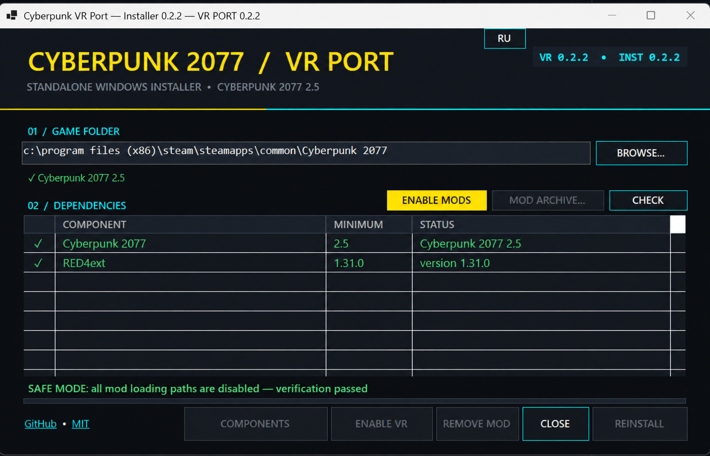

# Cyberpunk VR Port Installer

**English** | [Русский](README_RU.md)




An unofficial, self-contained Windows installer for
[Cyberpunk VR Port 0.2.3](https://github.com/dariulone/cyberpunk-vr-port/releases/tag/0.2.3).
It installs the VR port, validates game compatibility, helps install dependencies, and can safely
disable mods while troubleshooting crashes.

> [!IMPORTANT]
> This installer branch is intentionally pinned to Cyberpunk VR Port 0.2.3 and Cyberpunk 2077 2.5.
> Newer upstream releases may use a different layout and have different requirements.

## Features

- switches the complete interface between English and Russian and remembers the selected language;
- detects Cyberpunk 2077 installations from Steam, GOG, and Epic Games;
- checks the `Cyberpunk2077.exe` version at startup;
- installs the official VR Port 0.2.3 archive;
- installs the only required framework, RED4ext 1.31.0 or newer;
- installs manually downloaded Nexus Mods archives in ZIP, RAR, and 7z formats;
- backs up replaced files and safely removes the VR port;
- disables only the VR port while leaving shared components installed;
- provides a verified Safe Mode that temporarily disables mod loaders and mod directories;
- restores Safe Mode files and verifies the result;
- refuses to install into an invalid folder or while the game is running.

## Quick start

1. Download `CyberpunkVRPortInstaller-0.2.3.exe` from [Releases](../../releases).
2. Close Cyberpunk 2077 and run the installer as administrator.
3. Verify that the correct game directory and version 2.5 are displayed.
4. Select **Install components** to install or update RED4ext.
5. Select **Install**.
6. Start OpenXR/SteamVR, then launch Cyberpunk 2077.

The installer does not include the game, paid content, or Nexus Mods files.

## Dependencies and upgrades

VR Port 0.2.3 no longer requires CET, redscript, ArchiveXL, TweakXL, Codeware, Equipment-EX,
Input Loader, Visual Holsters, Valentino Holsters, Nova Optics, or More Occluders. The plugin now provides the required
Lua host, archive mounting, TweakDB changes, input merging, and script compilation itself.

Existing shared frameworks are not removed because other mods may still require them. During an upgrade,
the installer removes obsolete VR Port 0.1.9 files with backups before installing the new one-folder layout
under `red4ext\plugins\cyberpunkvrport`.

## Safe Mode

Safe Mode temporarily moves the following items into protected storage:

- `archive\pc\mod`, `mods`, `r6\scripts`, `r6\tweaks`, and `r6\input`;
- `red4ext\plugins` and `bin\x64\plugins`;
- RED4ext/CET and known proxy DLLs;
- `openvr_api.dll`.

Selecting **Enable mods** restores everything to its original location. The game must be closed before
switching modes. See [docs/TROUBLESHOOTING.md](docs/TROUBLESHOOTING.md) for detailed diagnostics.

> [!NOTE]
> A save created with mods may not load in Safe Mode. For a clean test, start a new game or use a save
> that does not depend on disabled mods.

## Requirements

- Windows 10/11 x64;
- Cyberpunk 2077 version 2.5;
- no separate .NET installation for the published EXE—the runtime is bundled;
- internet access only for automatic component downloads;
- administrator privileges to write into the game directory.

## Building from source

.NET SDK 8 or newer is required. `build.ps1` downloads the pinned official VR port archive when missing,
verifies its SHA-256, and embeds it together with a minimal licensed 7-Zip runtime.

```powershell
pwsh ./build.ps1
```

Output: `dist/CyberpunkVRPortInstaller-0.2.3.exe`.

Run the local self-test without modifying an installed game:

```powershell
dotnet ./bin/Release/net8.0-windows/win-x64/CyberpunkVRPortInstaller.dll --self-test
```

GitHub Actions validates every push and pull request. A `v*` tag builds the same EXE and attaches it
to a GitHub Release.

## Security and data

The installer does not collect telemetry or upload user data. Network requests are used for GitHub
Releases and for opening official Nexus Mods pages. Modified game files are backed up inside the
Cyberpunk 2077 directory.

Before experimenting with mods, back up
`%USERPROFILE%\Saved Games\CD Projekt Red\Cyberpunk 2077` separately.

## Contributing

See [CONTRIBUTING.md](CONTRIBUTING.md). Do not publish personal data or a complete memory dump in crash
reports unless necessary; `report.txt`, `stacktrace.txt`, and the VR port log are usually sufficient.

## Licenses and disclaimer

The installer source code is available under the [MIT License](LICENSE). Embedded component licenses
are listed in [THIRD-PARTY-NOTICES.txt](THIRD-PARTY-NOTICES.txt) and `vendor/7zip/License.txt`.

This project is not affiliated with CD PROJEKT RED, Valve, Meta, Nexus Mods, or the Cyberpunk VR Port
authors. Cyberpunk 2077 and related trademarks belong to their respective owners. Use mods at your own risk.

