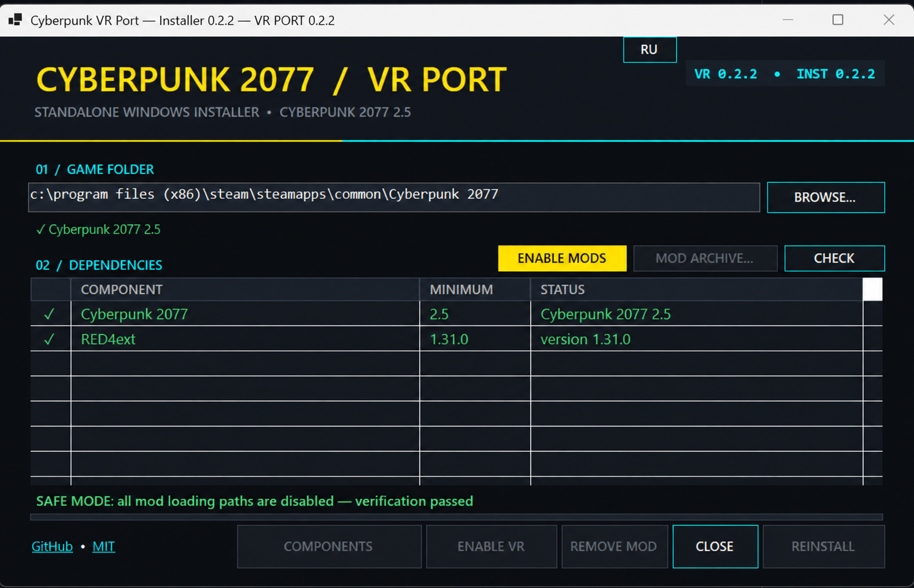

# Cyberpunk VR Port Installer

[English](README.md) | **Русский**




Неофициальный автономный Windows-инсталлятор для
[Cyberpunk VR Port 0.2.2](https://github.com/dariulone/cyberpunk-vr-port/releases/tag/0.2.2).
Он устанавливает VR-порт, проверяет совместимость игры, помогает поставить зависимости и умеет
безопасно отключать моды для диагностики вылетов.

> [!IMPORTANT]
> Эта ветка установщика намеренно закреплена на Cyberpunk VR Port 0.2.2 и Cyberpunk 2077 2.5.
> Более новые версии исходного VR-порта могут иметь другую структуру и требования.

## Возможности

- переключение всего интерфейса между русским и английским с сохранением выбранного языка;
- поиск Cyberpunk 2077 в Steam, GOG и Epic Games;
- проверка версии `Cyberpunk2077.exe` при запуске;
- установка официального архива VR Port 0.2.2;
- установка единственного обязательного фреймворка — RED4ext 1.31.0 или новее;
- установка вручную загруженных архивов Nexus Mods в форматах ZIP, RAR и 7z;
- резервное копирование заменяемых файлов и безопасное удаление VR-порта;
- отдельное отключение только VR-порта;
- проверяемый Safe Mode для временного отключения загрузчиков и каталогов модов;
- восстановление файлов после Safe Mode с проверкой результата;
- защита от установки в неправильную папку или при запущенной игре.

## Быстрый старт

1. Скачайте `CyberpunkVRPortInstaller-0.2.2.exe` на странице [Releases](../../releases).
2. Закройте Cyberpunk 2077 и запустите установщик от имени администратора.
3. Убедитесь, что определена правильная папка игры и отображается версия 2.5.
4. Нажмите **«Установить компоненты»**, чтобы установить или обновить RED4ext.
5. Нажмите **«Установить»**.
6. Запустите OpenXR/SteamVR и затем Cyberpunk 2077.

Установщик не включает игру, платные материалы или файлы Nexus Mods.

## Зависимости и обновление

VR Port 0.2.2 больше не требует CET, redscript, ArchiveXL, TweakXL, Codeware, Equipment-EX,
Input Loader, Visual Holsters, Nova Optics или More Occluders. Плагин сам предоставляет Lua-хост,
монтирование архива, изменения TweakDB, объединение ввода и компиляцию скриптов.

Общие фреймворки не удаляются, потому что они могут быть нужны другим модам. При обновлении установщик
с резервными копиями удаляет устаревшие файлы VR Port 0.1.9 и ставит новую структуру в одном каталоге
`red4ext\plugins\cyberpunkvrport`.

## Safe Mode

Safe Mode временно переносит в защищённое хранилище:

- `archive\pc\mod`, `mods`, `r6\scripts`, `r6\tweaks`, `r6\input`;
- `red4ext\plugins` и `bin\x64\plugins`;
- RED4ext/CET и известные proxy-DLL;
- `openvr_api.dll`.

Повторное нажатие **«Включить моды»** возвращает всё на прежние места. Переключать режим можно
только при закрытой игре. Подробная диагностика описана в
[docs/TROUBLESHOOTING_RU.md](docs/TROUBLESHOOTING_RU.md).

> [!NOTE]
> Сохранение, созданное с модами, может не загрузиться в Safe Mode. Для чистого теста начните новую
> игру или используйте сохранение, которое не зависит от отключённых модов.

## Требования

- Windows 10/11 x64;
- Cyberpunk 2077 версии 2.5;
- .NET не требуется для запуска готового EXE: runtime включён в сборку;
- интернет нужен только для автоматической загрузки компонентов;
- права администратора нужны для записи в папку игры.

## Сборка из исходников

Понадобится .NET SDK 8 или новее. Если официального архива нет, `build.ps1` скачивает закреплённую
версию, проверяет SHA-256 и встраивает её вместе с минимальным лицензированным runtime 7-Zip.

```powershell
pwsh ./build.ps1
```

Результат: `dist/CyberpunkVRPortInstaller-0.2.2.exe`.

Локальная проверка без изменения установленной игры:

```powershell
dotnet ./bin/Release/net8.0-windows/win-x64/CyberpunkVRPortInstaller.dll --self-test
```

GitHub Actions проверяет проект при каждом push/PR. Тег `v*` собирает тот же EXE и прикладывает его
к GitHub Release.

## Безопасность и данные

Установщик не собирает телеметрию и не отправляет пользовательские данные. Сетевые запросы нужны для
GitHub Releases и открытия официальных страниц Nexus Mods. Изменяемые файлы игры резервируются внутри
папки Cyberpunk 2077.

Перед экспериментами с модами рекомендуется отдельно сохранить папку
`%USERPROFILE%\Saved Games\CD Projekt Red\Cyberpunk 2077`.

## Участие в разработке

См. [CONTRIBUTING_RU.md](CONTRIBUTING_RU.md). В отчётах о вылетах не публикуйте персональные данные и
полный дамп без необходимости; обычно достаточно `report.txt`, `stacktrace.txt` и журнала VR-порта.

## Лицензии и отказ от ответственности

Код установщика распространяется по лицензии [MIT](LICENSE). Лицензии встроенных компонентов указаны
в [THIRD-PARTY-NOTICES.txt](THIRD-PARTY-NOTICES.txt) и `vendor/7zip/License.txt`.

Проект не связан с CD PROJEKT RED, Valve, Meta, Nexus Mods или авторами Cyberpunk VR Port.
Cyberpunk 2077 и связанные товарные знаки принадлежат их правообладателям. Используйте моды на свой риск.

